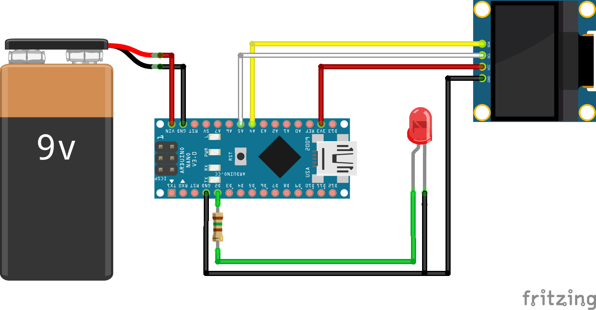
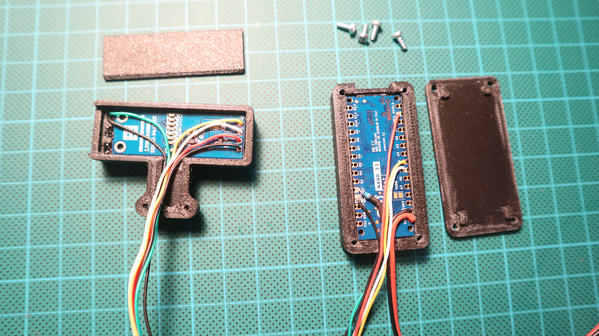

# Nano Inclinometer Building Instructions

## Parts required

* [Arduino Nano 33 iOT](https://docs.arduino.cc/hardware/nano-33-iot) microcontroller board. Note, other Arduino Nano boards won't work as they don't have the IMU sensors.
* 0.96" 128x64 I2C OLED display module (e.g. [this](https://www.aliexpress.com/item/1005003749452625.html))
* 3mm red LEDs. For aesthetics, I suggest populating all LED sockets with unwired LED-s.
* 150 ohm resistors. 1/8W small ones fit best.
* 28AWG wire
* CA glue

## Electronics

Input voltage is 5-18V (2S-4S LiPo).

## Software

Tweak the code to fit your installation:

* Adjust the roll / pitch limits that control the warning LED.
* The default mounting position for the Arduio board is face up, USB port forward. If the board is mounted in a different orientation, adjust / swap the pitch and roll angles accordingly.

## Hardware assembly

* Print the parts.
* Cut the housing to route the wires.
* Fit the LEDs in the LED sockets. Make sure that the bottom of the LED is flush with the socket. You may glue them in as well.
* Glue the faceplate to the housing.
* Wait for the glue to fully dry - the fumes of drying CA glue may damage the screen. (Ask me how I know.)
* Insert the screen and close the housing.